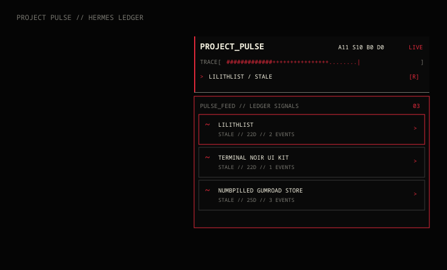

# Project Pulse

Project Pulse is a compact KDE Plasma 6 desktop instrument for the Hermes Ledger: a monochrome ASCII status strip with a connected three-card project feed beneath it.



The design is intentionally closer to a small terminal readout than a dashboard: black field, off-white text, pixel display type, and one red signal color. The main strip sits above the feed in the upper-right desktop quadrant and remains underneath normal application windows.

## What it uses

The parser reads `~/Documents/Hermes Ledger` and emits a small JSON snapshot containing project names, status, last activity, age, event count, and aggregate counts. Set `PROJECT_PULSE_LEDGER` before starting Plasma when the vault lives elsewhere. It does not display note bodies, credentials, private keys, or raw sensitive payloads.

- `org.scorn.projectpulse` — compact header, counts, animated trace, and rotating project focus.
- `org.scorn.projectpulsefeed` — connected lower surface with three compact project cards.
- Refresh cadence — once per minute, plus a click-to-refresh action on the main strip.
- Runtime — Python 3 and QtQuick / Plasma 6; no external package dependencies.

## Install

```bash
git clone https://github.com/numbpill3d/project-pulse-widget.git
cd project-pulse-widget
./install.sh
```

Then add **Project Pulse** and **Project Pulse Feed** from the Plasma widget picker. Place them together in the upper-right if Plasma has not restored the included layout automatically.

## Local development

```bash
python3 -m py_compile scripts/pulse.py feed/scripts/pulse.py
python3 scripts/pulse.py
```

The feed delegates intentionally read `root.snapshot.projects[index]` so cards stay bound to the live parser output rather than displaying ambiguous repeater metadata.

## License

MIT
